# FactoryScope

<p align="center">
  
  <br>
  <strong>Read-only diagnostics and troubleshooting for Mindustry factories.</strong>
  <br><br>
  <a href="https://github.com/Jovinull/FactoryScope/releases/latest">Latest release</a>
  &middot;
  <a href="https://github.com/Jovinull/FactoryScope/issues">Report an issue</a>
  &middot;
  <a href="docs/support-matrix.md">Support matrix</a>
</p>

FactoryScope helps you understand a building's current state and inspect the item, payload, power,
and liquid systems around it. It reads Mindustry's exposed state and conservative structural models;
it does not change blocks, inventories, power, or the world.

## What it includes

- **Building diagnostics** for operating state, recognized input shortages, output limits, and production
  rates for crafters, drills, pumps and extractors, separators, generators and reactors, unit factories, and
  turrets, each derived from the engine's own values and rules. What only an estimate can describe, such as a separator's
  random output or a turret's fire while it has targets, is marked as an estimate.
- **Area Diagnostics** to summarize selected friendly buildings and group their current findings.
- **Network** to inspect supported, resource-aware item and payload routes in a selected area,
  including Unit Cargo links.
- **Supply Trace** to follow structural item and payload routes to reachable producers, storage,
  boundaries, and unsupported transport.
- **PowerScope** to inspect Mindustry's power graphs and their current grid-level metrics.
- **LiquidScope** to inspect supported liquid and gas routes, producers, consumers, and stored
  liquids.

Where relevant, reports provide **Locate**, **Inspect**, **Return**, and **Refresh** actions to move
between evidence without losing the current report context.

## Screenshots

These are unedited captures of FactoryScope 1.3.0 running in the official Mindustry v160.7 client.
Acceptance fixtures create the displayed factory states; each PNG is captured directly from the game UI.

<table>
  <tr>
    <td width="50%">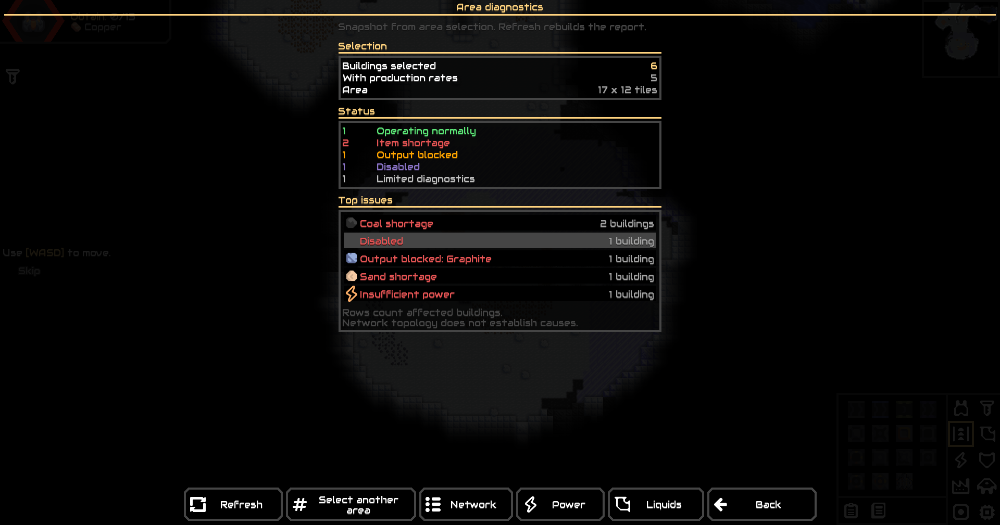<br><sub>Area Diagnostics groups current building findings.</sub></td>
    <td width="50%">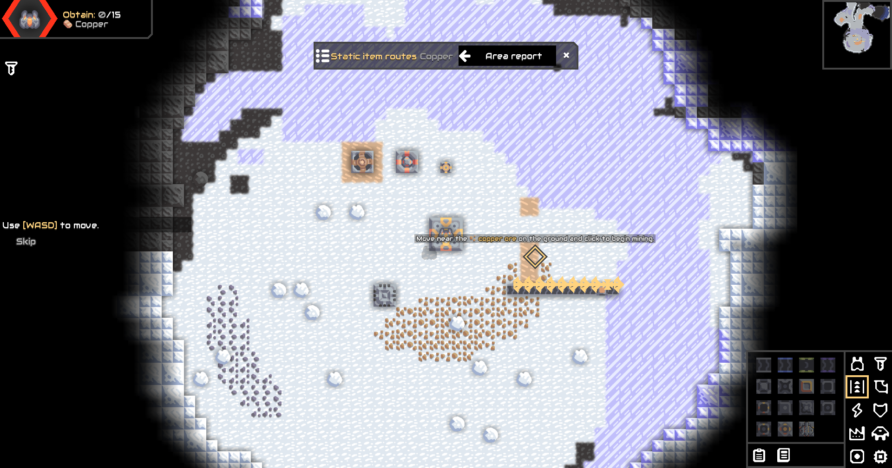<br><sub>Network shows supported structural resource routes.</sub></td>
  </tr>
  <tr>
    <td width="50%">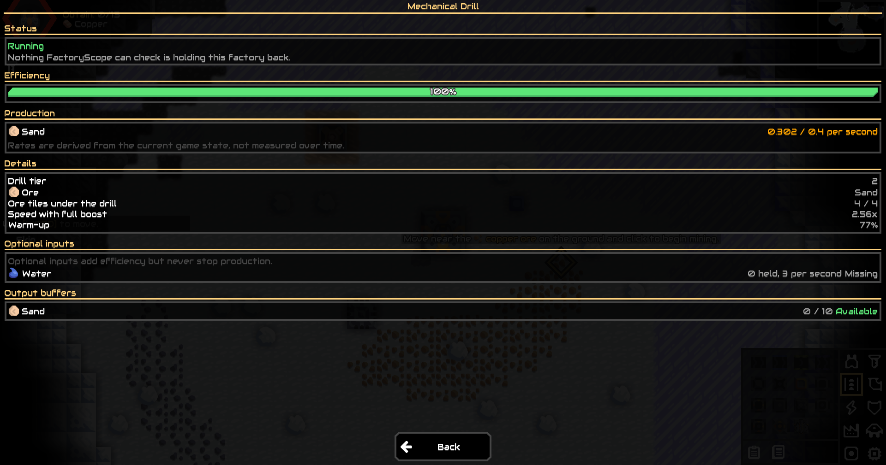<br><sub>Drill status, production estimate, ore and optional inputs.</sub></td>
    <td width="50%">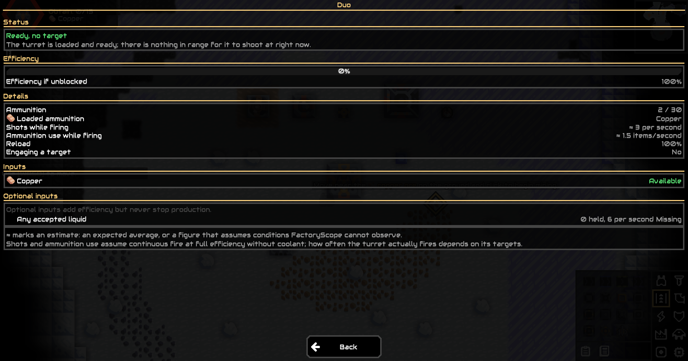<br><sub>Turret ammunition and readiness with no target in range.</sub></td>
  </tr>
  <tr>
    <td width="50%">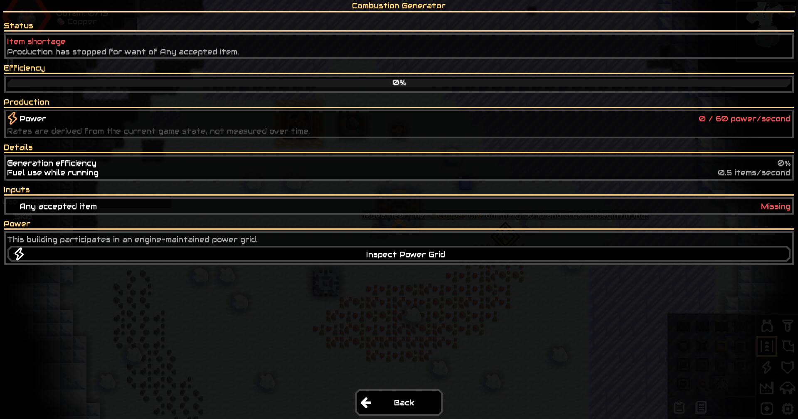<br><sub>Generator diagnostics include fuel requirements and its power grid.</sub></td>
    <td width="50%">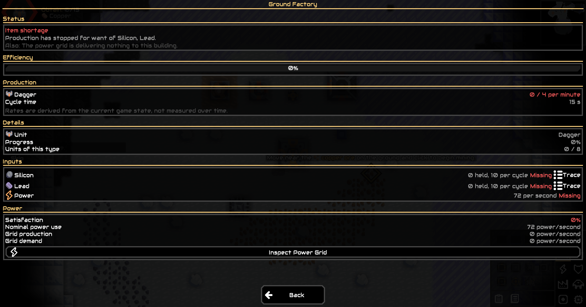<br><sub>Unit Factory diagnostics show the selected unit and its inputs.</sub></td>
  </tr>
  <tr>
    <td width="50%">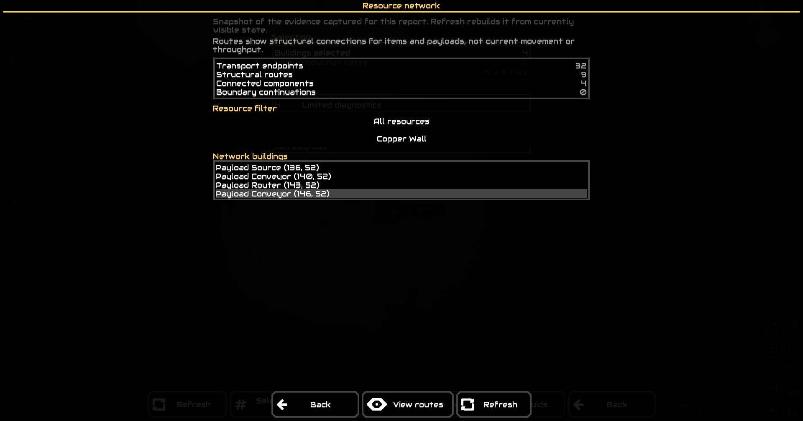<br><sub>Payload routes retain whole-block identity through conveyors and routers.</sub></td>
    <td width="50%">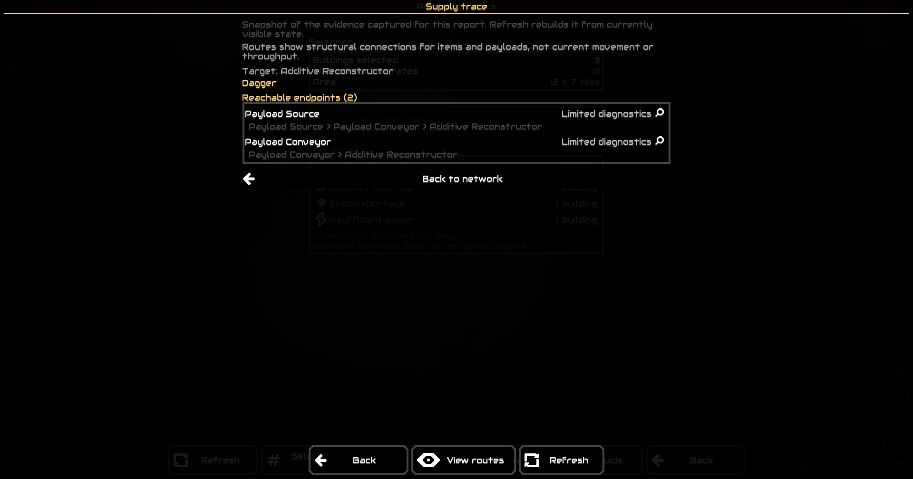<br><sub>Supply Trace follows accepted units into a Reconstructor.</sub></td>
  </tr>
  <tr>
    <td width="50%">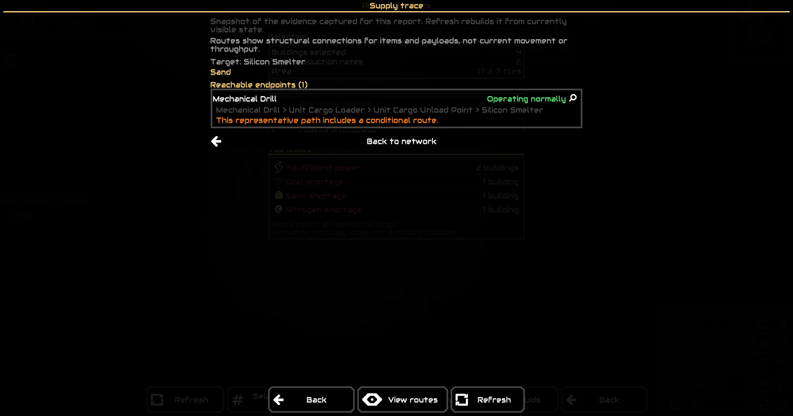<br><sub>Unit Cargo links join the item trace between same-team buildings.</sub></td>
    <td width="50%">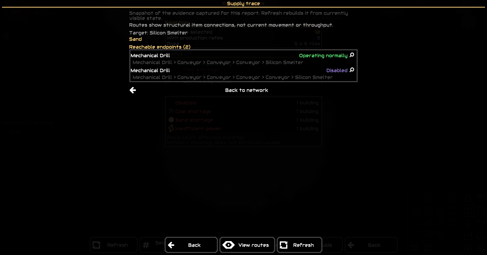<br><sub>Supply Trace preserves reachable endpoints and known dead ends.</sub></td>
  </tr>
  <tr>
    <td width="50%">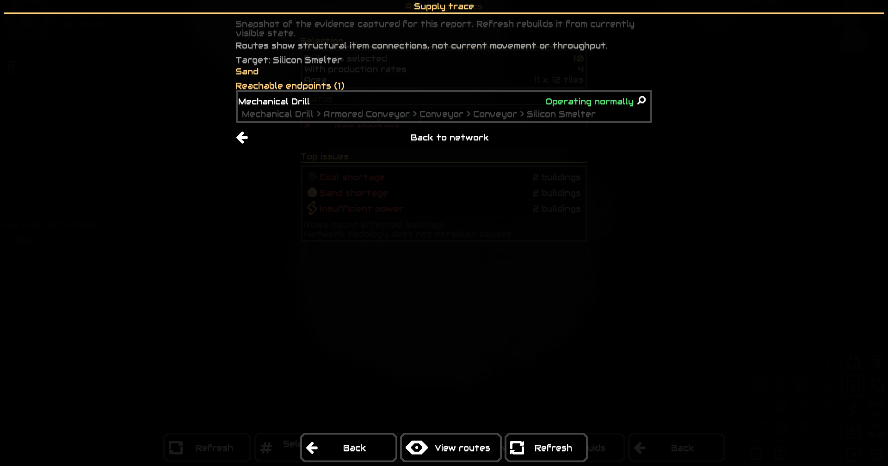<br><sub>Item traces include the supported Armored Conveyor route.</sub></td>
    <td width="50%">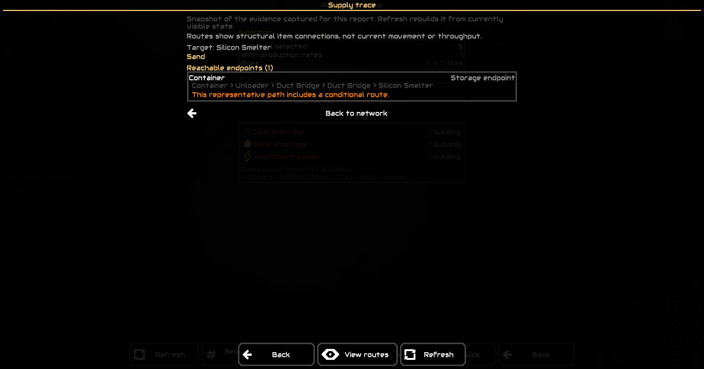<br><sub>Item traces show routes through an Unloader and Duct Bridges.</sub></td>
  </tr>
  <tr>
    <td width="50%">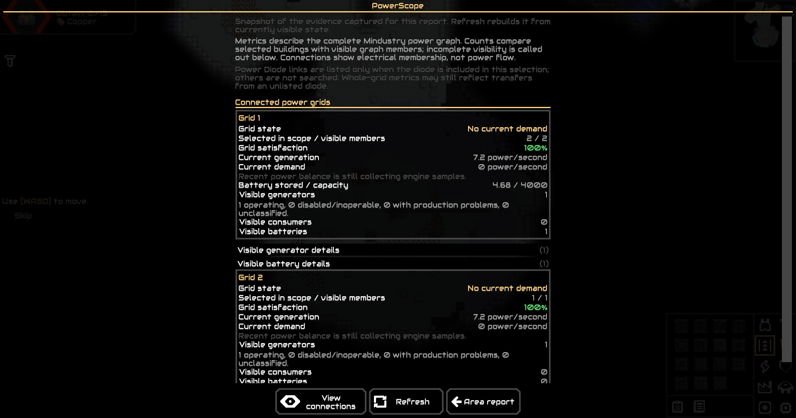<br><sub>PowerScope compares grid-level metrics, not per-wire flow.</sub></td>
    <td width="50%">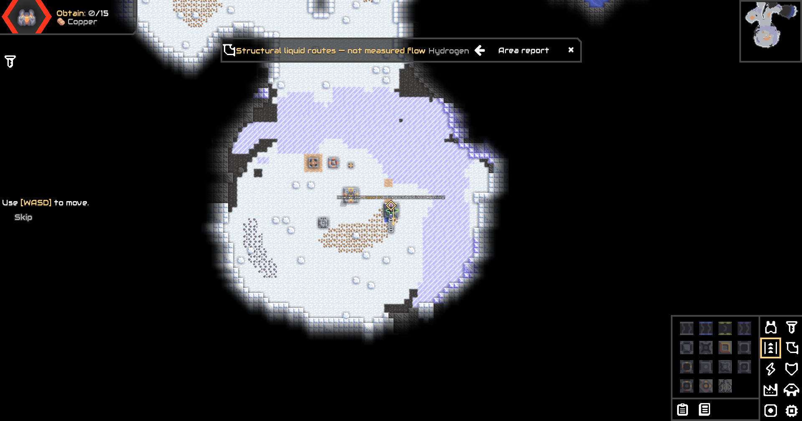<br><sub>LiquidScope handles Mindustry gas resources by exact content identity.</sub></td>
  </tr>
  <tr>
    <td width="50%">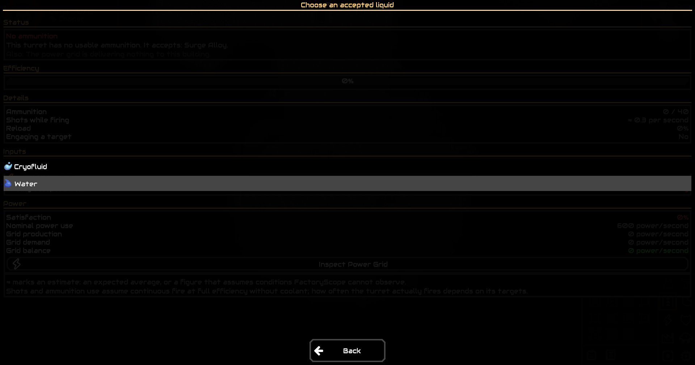<br><sub>Filter consumers expose the accepted liquid choices.</sub></td>
  </tr>
</table>

## Install

**Mod Browser:** search for FactoryScope and install it. The listing is generated from GitHub and may
take a scheduled index refresh to reflect a new release.

**Steam Workshop:** subscribe to
[FactoryScope on the Steam Workshop](https://steamcommunity.com/sharedfiles/filedetails/?id=3820843151)
and start Mindustry from Steam. The Workshop item carries the same jar as the GitHub release.

**GitHub Releases:** download [`FactoryScope.jar`](https://github.com/Jovinull/FactoryScope/releases/latest)
and import it from Mindustry's Mods menu. This is the manual fallback if the browser listing has not
updated yet.

Install FactoryScope from only one of these sources. Every copy uses the mod name `factory-scope`, and
Mindustry will not load a second mod with the same name.

## Use

In a game, activate the FactoryScope button below the wave/editor HUD layout area. Click a building
for its current diagnostics, or drag a rectangle for Area Diagnostics. Open Network, PowerScope, or
LiquidScope from the area report, then trace a resource where supported. Use **Locate**, **Inspect**,
and **Return** to navigate; use **Refresh** to rebuild snapshot evidence after the factory changes.

FactoryScope includes translations in English, Portuguese (Brazil), Russian, Simplified Chinese,
Korean, and Spanish. Localization terminology follows Mindustry v160.5 where applicable; see the
[localization glossary](docs/localization.md). Contributions and corrections are welcome through
the issue tracker.

## What the evidence means

The single-building inspector refreshes while open. Area Diagnostics, Network, Supply Trace,
PowerScope, and LiquidScope reports are snapshots; **Refresh** reconstructs their evidence.

Item, payload and liquid routes mean **structural possibility**, not current movement. PowerScope reports
engine-maintained grid metrics; an electrical connection is not a measurement of flow through a
wire. A reachable producer does not prove quantitative supply sufficiency or explain the cause of a
building's state. Payload and Unit Cargo routes follow the same structural-evidence limits.

FactoryScope does not measure per-edge item or liquid throughput, per-wire power flow, future
battery depletion, or quantitative supply sufficiency. It does not rank root causes or recommend
repairs. Unsupported and partial transport remains visibly incomplete rather than being guessed as a
valid route or a proven dead end. Unit Cargo links identify same-team loaders and configured unload
points; cargo movement and unload timing are not measured. Payload routes trace whole blocks or units
through supported transports, but do not measure transfer timing or prove that a payload is currently
moving.

## Support and validation

FactoryScope targets Mindustry v8 Build 160 (`minGameVersion: 160`). FactoryScope 1.3.0 is validated
against v160.7 in all six languages. The
[support matrix](docs/support-matrix.md) lists modeled, partial, and deferred transport families.
Common conveyor/conduit routes, junctions, routers, sorters, configured item
bridges, and the Armored Conveyor/Armored Duct insertion rules are modeled, and so are every other vanilla
item and liquid transport: Plastanium and Surge Conveyors, Duct Bridges, Unloaders and Duct Unloaders, Mass
Drivers, armored conduits, and liquid bridges. Unit Cargo links and payload conveyors, routers,
eligible storage loaders/unloaders, deconstructors, constructors, reconstructors, assemblers, and mass
drivers are modeled with explicit resource constraints. Unknown custom routing stays conservative.

Desktop graphical acceptance has been performed on Windows. Launcher/path tests run on Windows,
Linux, and macOS; that is not graphical validation on those platforms. The universal JAR contains a
structurally validated DEX. Android runtime and touch were validated in an Android 15 (API 35)
x86_64 emulator running Mindustry Android v160.7. The check covered the HUD button, taps, the target
picker, drag selection, dialogs, Locate/Return navigation, and the mobile UI layout; a physical
Android phone has not been independently checked. Multiplayer has been validated with an official
v160.7 dedicated server and client: on a fog-of-war server, the client reaches the same diagnoses,
area reports, traces, and power grids as the server, and enemy buildings hidden by fog stay out of
reach.

## Bug reports and development

[Open an issue](https://github.com/Jovinull/FactoryScope/issues/new/choose) with the form that fits: a
bug, a diagnosis the game contradicts, a feature request, or a translation problem. Each form asks for the
Mindustry build, how to reproduce it, and a screenshot or log excerpt. The project favors
reproducible tests and engine-backed evidence over speculative fixes.

Builds require JDK 17. The Gradle wrapper downloads the pinned build dependencies.

```text
gradlew.bat clean test acceptanceLauncherTest jar acceptanceJar verifyArtifacts  # Windows
./gradlew clean test acceptanceLauncherTest jar acceptanceJar verifyArtifacts    # Linux/macOS
gradlew.bat acceptanceTest                                                       # Windows
./gradlew acceptanceTest                                                        # Linux/macOS
```

`acceptanceTest` launches a real Mindustry v160.7 desktop client in an isolated sandbox. For an
explicit client and artifact:

```text
./gradlew acceptanceTest -PmindustryJar="/games/Mindustry.jar" -PmodJar="/artifacts/FactoryScope.jar" -Plocale=pt-BR
```

`jar` builds the desktop JAR. The universal release JAR, including `classes.dex`, is built by `deploy`
with Android build tools available. Informational benchmarks are `areaBenchmark`, `networkBenchmark`,
`traceBenchmark`, `powerBenchmark`, and `liquidBenchmark`; they have no timing pass/fail thresholds.
See [testing](docs/testing.md), [architecture](docs/architecture.md), and [release procedure](docs/releasing.md).

## License

FactoryScope is licensed under [GPL-3.0](LICENSE).
